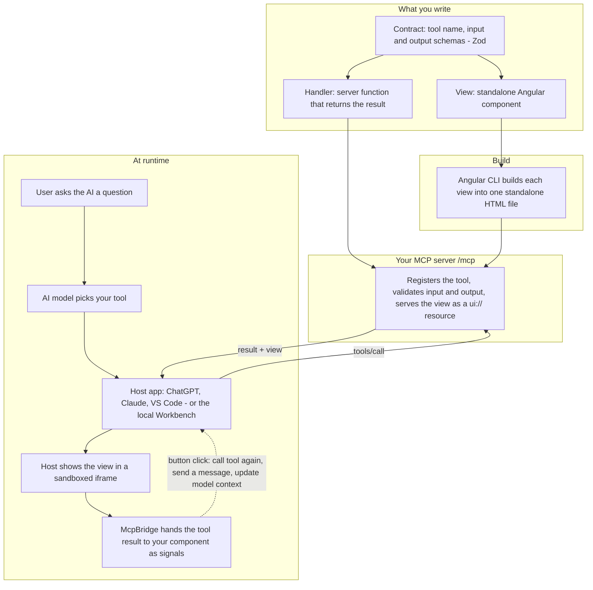

<p align="center">
  
</p>

<h1 align="center">Angular MCP Bridge</h1>

<p align="center">
  Build interactive <a href="https://modelcontextprotocol.io">MCP Apps</a> with Angular.<br>
  Add your Angular UI to an AI conversation, backed by your own server tools.
</p>

<p align="center">
  <a href="https://www.npmjs.com/package/@angular-mcp-bridge/cli"></a>
  <a href="LICENSE"></a>
  
  
</p>

<p align="center">
  <a href="#quickstart">Get started</a> ·
  <a href="#existing-angular-project">Existing Angular app</a> ·
  <a href="#how-it-works">How it works</a> ·
  <a href="docs/index.md">Documentation</a> ·
  <a href="docs/HOST-SETUP.md">Connect a host</a>
</p>

---

## What does this package do?

Angular MCP Bridge lets an AI call your backend and show an interactive Angular view inside the conversation.

For example, with a CV app, a user could ask **“Show me my work experience.”** Your server tool returns your experience data, and the host displays your Angular CV view. The user can then interact with that view.

You build two parts:

| Part | What you write | Where it runs |
| --- | --- | --- |
| **Tool** | A named server function with an input/output contract, such as `show_cv` | Your Node.js MCP server |
| **View** | A standalone Angular component that displays the tool result | Inside the AI host’s sandboxed iframe |

**MCP** is the protocol the host uses to discover and call tools. A **host** is an application such as ChatGPT, Claude or VS Code. The included **Workbench** is a local host simulator: use it to build and test without an AI account or API key.

The bridge supplies the connection, typed contracts, Angular signals, generators and local tooling. You supply your UI, data and server handlers.

## Why Angular MCP Bridge

- **One typed contract.** Define a tool's input and output once with Zod. The server handler and the Angular view share the types, so a mismatch fails at compile time.
- **Angular all the way.** Standalone components, signals, dependency injection, `resource()` and `DestroyRef`. No React runtime.
- **Develop without a host account.** The Workbench simulates a host locally, with an inspector, saved inputs, fixtures and host profiles.
- **Works with your existing app.** `ng add` integrates the bridge without touching your UI; `ng generate` adds typed tools and views.
- **Built on the official SDKs.** Runs on `@modelcontextprotocol/*`, with optional OAuth, middleware, events and Signal Forms.

## Quickstart

Choose the path that matches your project:

| Your starting point | Start here |
| --- | --- |
| I already have an Angular app | [Add the bridge to your existing project](#existing-angular-project) |
| I want a new MCP App | [Create a new project](#new-project) |
| I only want to try the repository demo | [Run the included demo](#run-the-included-demo) |

Requirements: Node **22.22.3+**, **24.15+** or **26+** (see [prerequisites](docs/GETTING-STARTED.md#before-you-start)). For an existing app, Angular **22** with a standalone bootstrap; NgModule apps must migrate to `bootstrapApplication` before `ng add`.

### Existing Angular project

Run these commands **from your Angular workspace root**—the folder containing `angular.json`. You do not need to clone this repository.

```sh
npx ng add @angular-mcp-bridge/cli
npm run mcp:dev
```

If your workspace contains several applications, select one:

```sh
npx ng add @angular-mcp-bridge/cli --project my-app
```

Replace `my-app` with its project name from `angular.json`. Commit your current work before installation so you can review the generated changes.

`ng add` installs the packages, adds the bridge provider to your bootstrap, creates a Node.js server in `mcp/`, and adds a separate Workbench. Your existing components, routes, styles and original npm scripts are preserved.

**Try it:** open the printed **Workbench URL**, select the generated greeting tool, and click **Run tool**. Your app appears in the preview, and **Tool result** shows the returned greeting. Your existing UI displays that data only after you bind it to a bridge signal; installation does not connect your backend automatically.

**Build your first real feature:** stop the dev process, then generate a dedicated CV view and tool:

```sh
npx ng generate @angular-mcp-bridge/cli:view cv-panel --tool show_cv
npm run mcp:dev
```

The generator registers the new feature automatically. Edit these files in **your project**:

| File | What to change |
| --- | --- |
| `mcp/features/show_cv/contract.ts` | The tool’s description, input and output schemas |
| `mcp/features/show_cv/handler.ts` | Return your CV data or call your backend |
| `apps/cv-panel/src/app.ts` | Render the result with Angular; the generated component already reads it |

Choose the new tool in the Workbench, enter its arguments and click **Run tool**. The initial generated example returns a greeting; replace its contract, handler and template together to display CV data. Backend credentials belong in the server handler, outside the shared contract and frontend.

To display results in **your existing component** instead of a new view, follow the complete [existing-app walkthrough](docs/EXISTING-APP.md#display-a-result-in-your-existing-ui). It includes a copyable Angular component and explains which generated tool opens your original app.

Use `npm run mcp:doctor` for diagnostics and `npm run mcp:build` for production builds. Existing apps use the **`mcp:*` scripts**; your usual Angular commands keep their original purpose.

### New project

```sh
npx @angular-mcp-bridge/cli create my-angular-app
cd my-angular-app
npm install
npm run dev
```

Open the printed **Workbench URL**. The starter includes working example tools and Angular views. Select a tool and click **Run tool** to see the server result and its view.

Stop dev before generating another feature:

```sh
npx ng generate @angular-mcp-bridge/cli:view cv-panel --tool show_cv
npm run dev
```

New starters use these paths:

| File | Purpose |
| --- | --- |
| `examples/generated/show_cv/contract.ts` | Input/output schemas and tool description |
| `examples/generated/show_cv/handler.ts` | Server implementation |
| `apps/cv-panel/src/app.ts` | Angular view |

Follow [Build your first tool and view](docs/FIRST-APP.md) for complete file contents and a working greeting example. New starters use `npm run dev`, `build`, `start` and `doctor`; existing-app integrations use their `mcp:*` equivalents.

## How it works



1. The host discovers your tool names, descriptions and argument schemas from the MCP server.
2. When the host calls a tool, the server validates its input and runs your handler.
3. The handler returns data. The server also identifies the Angular view associated with that tool.
4. The host opens that view in an iframe. `McpBridge` exposes the result and host state as Angular signals.
5. Your view can make further tool calls, share context or send messages when the host supports those actions.

A shared **contract** keeps the server and view types consistent. Components use Angular’s standalone APIs, dependency injection, signals, `resource()` and `DestroyRef`.

## Use it with a hosted website

Your website can keep running at its existing URL. The MCP integration also needs a **public HTTPS server endpoint**, such as `https://your-server.example/mcp`, which the AI host connects to.

Build with `npm run mcp:build` in an existing app, or `npm run build` in a starter. Start the MCP server with the matching `mcp:start` or `start` command in your hosting environment. The build creates the Angular view resources; the server serves them through MCP. Configure hostnames, origins and authentication for your deployment.

A frontend-only host needs a separate Node.js service for the MCP server. Your handlers can call the same backend that your website uses. For a routed or authenticated app, check [existing-app adaptation](docs/EXISTING-APP.md#things-to-check-in-your-app) before embedding it.

See [Host setup](docs/HOST-SETUP.md) for connection instructions and [Server guide](docs/SERVER.md) for backend integration and authentication. Workbench success establishes local behavior; verify the finished app in your target host.

## Find your next step

| I want to… | Read |
| --- | --- |
| Adapt my existing Angular UI | [Existing-app walkthrough](docs/EXISTING-APP.md) |
| Build my first typed tool and view | [First app tutorial](docs/FIRST-APP.md) |
| Understand setup, folders and the Workbench | [Getting started](docs/GETTING-STARTED.md) |
| Call tools, load data or persist state | [Angular recipes](docs/RECIPES.md) and [API reference](docs/ANGULAR-API.md) |
| Connect a backend or add authentication | [Server guide](docs/SERVER.md) |
| Connect a real AI host | [Host setup](docs/HOST-SETUP.md) |
| Use generators, build or deploy | [Native tooling](docs/TOOLING-NATIVE.md) and [Tooling guide](docs/TOOLING.md) |
| Compose reads, cache safely or preserve editing drafts | [Runtime recipes](docs/RUNTIME.md) |
| Use Signal Forms or experimental WebMCP | [Forms and WebMCP](docs/FORMS-AND-WEBMCP.md) |
| Measure performance or evaluate tools | [Performance](docs/PERFORMANCE.md) and [Evaluations](docs/EVALUATIONS.md) |
| Fix a setup problem | [Troubleshooting](docs/TROUBLESHOOTING.md) |

The [documentation index](docs/index.md) lists all guides. Optional host features depend on the host’s capabilities. WebMCP remains experimental.

## Run the included demo

For trying this repository itself, use a supported Node version and run from its root:

```sh
npm install
npm run dev
```

Open the printed **Workbench URL**. Select **Project overview** to browse demo data or **Angular integration lab** to try resources and UI tools. Choose **Angular dev server · HMR** in Preview source, edit `apps/demo/src/app.ts`, and save. Ctrl+C stops development; use the printed URLs because dev selects free ports.

To create an app using your local framework build, run `npm run create -- ../my-angular-app --install`.

## Framework development

```sh
npm test
npm run check
npm run docs:check
npm run build
npm run pack:all
```

Browser tests use `npm run test:e2e`; install Chromium with `npx playwright install chromium` or set `BROWSER_EXECUTABLE` to a compatible browser. `npm run preview` serves an existing production build at `http://127.0.0.1:3000`.

Read [Architecture](docs/ARCHITECTURE.md) for implementation details.
