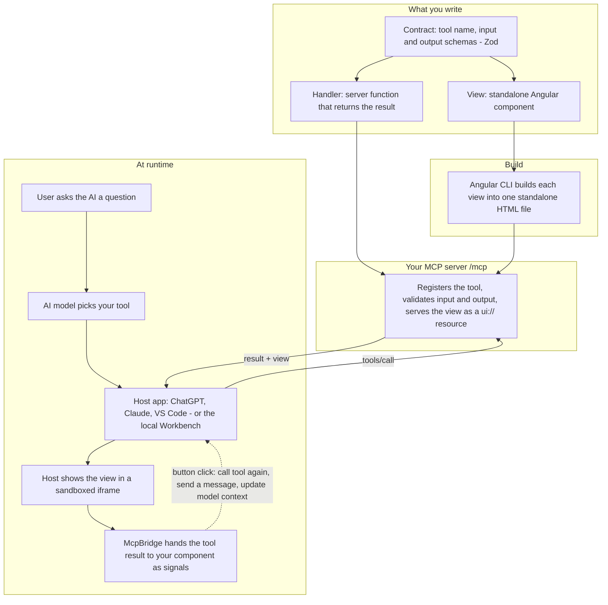

# Angular MCP Bridge

Build interactive MCP Apps with Angular 22.2.2. Define a typed tool, write a standalone Angular view, and test them together in the local workbench. Angular signals, dependency injection, `resource()` and `DestroyRef` handle view state and cleanup.

## How it works

An MCP App is a tool the AI can call, plus a small web page (the **view**) the host shows inside the chat. This project lets you build both with typed code and write the view in Angular.



**In plain words**

1. You describe a tool once in a **contract**. Input and output types are shared by the server and the view, so a mismatch fails at compile time.
2. The **server** runs your handler when the AI calls the tool. It checks the input before the handler runs and the output before it is returned.
3. The **view** is a normal Angular component. It is built into a single HTML file that the server offers to the host.
4. The **host** shows that view inside the conversation. `McpBridge` connects the iframe to the host and exposes the tool result, host info and actions as Angular signals.
5. From the view you can call the tool again, send a follow-up message to the chat, or update what the model can see.

## How to use it

```sh
npm install
npm run dev                       # start the server, views and Workbench
npm run add-view -- greeting      # create a new tool and Angular view
```

1. **Start:** run `npm run dev` and open the **Workbench** URL it prints. The Workbench plays the role of the host, so you need no ChatGPT or Claude account to develop.
2. **Create:** `npm run add-view -- greeting` generates a working tool (`examples/generated/open_greeting/contract.ts` and `handler.ts`) and a view (`apps/greeting/src/app.ts`).
3. **Try:** in the Workbench select the tool, fill in the arguments and click **Run tool**. The view renders in the preview and the inspector shows the raw request and result.
4. **Edit:** change the schemas in `contract.ts`, the logic in `handler.ts` and the template in `app.ts`. Choose **Angular dev server · HMR** as the preview source to see edits instantly.
5. **Ship:** `npm run build` writes the server bundle and one HTML file per view. `npm run start` serves them. Follow [Host setup](docs/HOST-SETUP.md) to connect ChatGPT, Claude or VS Code, and [Server guide](docs/SERVER.md) for authentication.

The step-by-step version is in [Build your first tool and view](docs/FIRST-APP.md).

## Try the included app

From this folder, with Node 24.15.0 or another [supported version](docs/GETTING-STARTED.md#before-you-start):

```sh
npm install
npm run dev
```

Open the **Workbench** URL printed in your terminal. You should see **connected**, four server tools, and the project browser. Click **Run tool**, select **Ready**, then open **Angular integration lab** to try resources and UI tools. Local development needs no API key or host account.

Choose **Angular dev server · HMR** under Preview source, edit `apps/demo/src/app.ts`, and save to see the view update. Use Ctrl+C in the terminal to stop development. The CLI selects available ports, so use the printed URLs.

## Create your own app

After installing this workspace's dependencies, run:

```sh
npm run create -- ../my-angular-app --install
cd ../my-angular-app
npm run dev
```

The create command prepares local framework packages, copies the starter into an empty folder and installs its dependencies. The new app runs independently of this checkout. Omit `--install` to install separately. **These packages are not published to npm yet**; the local creator is the supported setup path today.

Then follow [Build your first tool and view](docs/FIRST-APP.md). It walks from `add-view` to a working greeting, with complete file contents and the exact server binding.

## Find your next step

| I want to… | Read |
| --- | --- |
| Start the app and understand the folders | [Getting started](docs/GETTING-STARTED.md) |
| Build a tool with an Angular view | [First app tutorial](docs/FIRST-APP.md) |
| Call tools, load data, persist state or open a modal | [Angular recipes](docs/RECIPES.md) and [API reference](docs/ANGULAR-API.md) |
| Connect a backend or add authentication | [Server guide](docs/SERVER.md) |
| Test in ChatGPT, Claude or VS Code | [Host setup](docs/HOST-SETUP.md) |
| Add views, build, use a tunnel or prepare deployment | [Tooling guide](docs/TOOLING.md) |
| Use Angular generators or preserve deferred chunks | [Native tooling](docs/TOOLING-NATIVE.md) |
| Compose reads, cache safely or edit without losing drafts | [Runtime recipes](docs/RUNTIME.md) |
| Validate forms or expose browser-agent tools | [Signal Forms and WebMCP](docs/FORMS-AND-WEBMCP.md) |
| Measure bundle sizes and local interactions | [Performance](docs/PERFORMANCE.md) |
| Evaluate tool behavior with a model | [Evaluation guide](docs/EVALUATIONS.md) |
| Fix a setup or runtime issue | [Troubleshooting](docs/TROUBLESHOOTING.md) |

The [documentation index](docs/index.md) lists the learning path and references. Run `npm run doctor` for local setup diagnostics; it prints the next command when something is missing.

## What is included

Five local packages provide shared Zod contracts, an Angular bridge, a typed MCP server, development/build tooling and model evaluations. Native Angular schematics generate contracts, handlers and views together. The runtime adds resource composition, scoped read caching, draft-safe editing and batched model context. Optional entry points provide typed Signal Forms and experimental WebMCP. The accessible workbench includes input forms, saved arguments, resources, prompts, UI tools, context inspection and fixture replay.

Start with the demo; enable those features when your app needs them. Host-shaped workbench profiles are simulations. Live host acceptance, provider accounts and public hosting need verification in their respective environments.

## Framework development

```sh
npm test
npm run check
npm run docs:check
npm run build
npm run pack:all
```

Browser tests use `npm run test:e2e`; install Chromium with `npx playwright install chromium` or set `BROWSER_EXECUTABLE` to an existing compatible browser. `npm run preview` serves an existing production build at `http://127.0.0.1:3000`.

Read [Architecture](docs/ARCHITECTURE.md) for implementation details.
