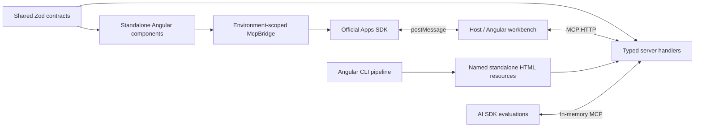

# Architecture

## Angular ownership

provideMcpBridge creates an environment-scoped service and view-context registry. Signals expose host state. Reactive read-only tools and file reads use Angular resource(); commands use explicit execution. DestroyRef owns cancellation, tool removal and context cleanup. The async handshake does not block bootstrap. Standard MCP Apps is preferred; a framed host with a usable legacy SDK gets a bounded unanswered-handshake probe before fallback. Explicit mcp/legacy modes and probe duration are configurable. A rejected standard handshake remains an error. Top-level widget pages require a host unless a usable legacy SDK is supplied; SSR avoids browser transport.

Transport generation guards prevent old callbacks and resource disposers from affecting a replacement connection. disconnect/reconnect/retryConnect are explicit. Closing a bridge releases transport state; component-owned contributions and listeners are cleaned independently. Optional read caches follow the bridge, connection epoch and application-owned authorization scope. Draft editing uses linked signals to preserve the original version; shared context writers coalesce at the bridge boundary. See [runtime patterns](RUNTIME.md).

Standalone DataLlmDirective describes selected visible content. It coalesces updates and unregisters descriptions on destruction. McpModalOutlet renders TemplateRef or standalone component content using Angular; local dialogs stay within the iframe.

## Contract and model boundaries

Contracts contain no Node imports. Tool names, frontend input and handler output are inferred from shared schemas. Frontend validation preserves the original wire arguments so server transforms occur once. Server handlers receive parsed values; structured output is validated again before delivery.

Tool _meta stays outside model-visible structuredContent. Workbench fixture export and evaluation transcripts remove private metadata. Widgets use the host's tools/resources bridge rather than direct HTTP calls to the backend.

Local view state remains private until explicitly shared. Persisted envelopes require unique application keys, schema and version. ChatGPT widget-state read-modify-write operations share one bridge queue, preserving independent state envelopes and image identifiers even when host globals lag behind writes. Custom stores must expose a hydrated synchronous read boundary.

## Server and protocol

The server uses the maintained MCP SDK request factory and public registration APIs. HTTP binds loopback by default, validates Host/Origin, and supports explicit deployment allowlists. OAuth protected-resource metadata, public-client discovery and jose JWT verification are optional. Tool security alternatives and scopes are enforced before handlers. Other custom resources/methods must enforce their own authorization, or use endpoint-wide required authentication.

Middleware wraps application handler registration, including configure hooks. It excludes protocol initialization/transport internals. Telemetry receives method/status/duration and original exceptions without automatically copying arguments or credentials.

Modern HTTP notifications use the SDK subscriptions/listen stream and injected event bus. The workbench negotiates modern protocol with legacy fallback, translates Apps resource subscriptions to the negotiated method, and closes streams on remount/disconnect. Legacy standalone SSE support depends on the transport configuration. A legacy optional GET returning 405 does not prevent request/response tool calls.

Forms use SDK native input-required results; rich OpenAI forms require an explicit extension. Webhook events are a provisional extension with authenticated subscriptions, signed challenge/delivery and explicit application storage/retry hooks.

## Build and development

Each view.json maps a named view to an Angular CLI application. Native Angular schematics integrate an existing standalone app and generate contracts/handlers/views through configured registries. The CLI generates literal view names and invokes native Angular builds. The default delivery flattens JavaScript through esbuild and inlines supported local styles/assets. Optional HTTPS asset delivery preserves lazy chunks and verified prior release assets. Both modes emit a portable manifest; unsupported asset patterns fail visibly. Content hashes version server resource URIs.

Development selects available IPv4/IPv6 ports, starts the API watcher, workbench and one Angular HMR server per view, and waits for readiness. Runtime manifests expose only public loopback URLs to the workbench. The development iframe allows same-origin within its own cross-origin local dev server; production resources use an opaque sandbox. Both permit scripts and native form events; production CSP blocks network form navigation so Signal Forms submit through MCP.

## Workbench and evaluation

Workbench profiles advertise capabilities actually handled by the simulator. Profile changes renegotiate through remount; theme/locale/device updates use host context. Messages/context are recorded for inspection. Fixtures replay initial tool results without repeating server calls; subsequent view actions still use the live server.

Browser OAuth uses public-client PKCE through the official SDK, tab-scoped endpoint/issuer credentials, callback-state validation and sign-out cleanup. Registration requires IdP DCR or a pre-registered public client. Tokens are never added to event logs/fixtures.

WebMCP registration is explicit and feature detected. Only model-visible tools are exposed; execution forwards cancellation and strips private metadata. Its browser API remains experimental.

The evaluation package connects real MCP tool descriptors through in-memory transports, then lets a user-supplied AI SDK model select tools. Stubs preserve real server validation/authorization. Deterministic tests isolate runner behavior from paid model quality.
